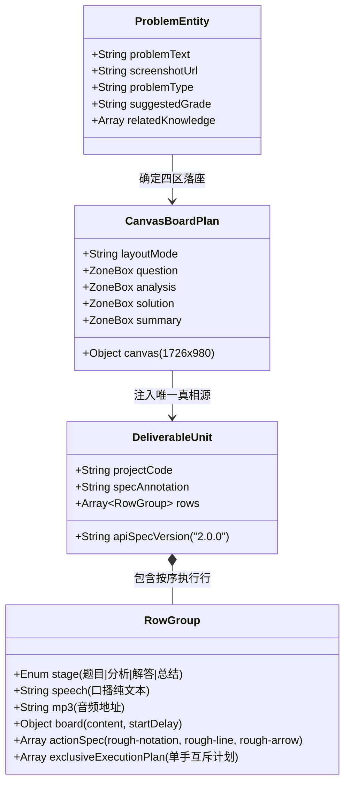
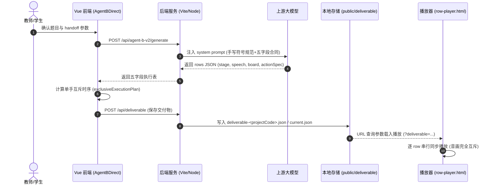

# 项目体检报告与标准化交付成果

**执行标准**：依据《项目入手工作流》规范（摸清底座 → 止血排查 → 语义建模与 Agent Context Layer → 契约治理 → 验证交付）。
**项目定位**：小学数学讲解视频生成工作台（青花布 DaVinci 草稿手稿风格，五字段执行表生成，端到端单手互斥板书微课合成器）。

---

## 1. 技术栈与运行底座识别报告

| 维度 | 检测结果 | 证据与源码位置 |
|---|---|---|
| **运行时环境** | Node.js 22+ / Bun 兼容，Vite 8.1.1 驱动 | `package.json`, `docker-compose.base44.yml` |
| **前端架构** | Vue 3.5 (SFC Composition API) + Ant Design Vue 4.x + Tailwind CSS | `src/main.js`, `src/agent-b-v2/AgentBDirect.vue` |
| **渲染与矢量库** | Rough.js (手绘矢量线条/箭头) + Rough-notation (文字批注) + HTML5 Canvas | `src/board-tools/roughDrawingTool.js`, `public/row-player.html` |
| **数学与排版引擎** | KaTeX (前端辅助展示) + 原生手写体标点排版系统 (免 LaTeX 拆碎) | `src/agent-b-v2/prompt.js`, `src/utils/mathText.js` |
| **后端服务架构** | Vite Connect Middleware 统一单源服务 + `server/productionServer.js` (Bun/Node 独立常驻服务) | `vite.config.js`, `server/productionServer.js` |
| **持久化存储** | 本地 `public/` 目录持久化挂载卷（`public/handoff/`, `public/deliverable/`, `public/audio-cache/`, `public/pic/`） | `server/deliverableStoreHandler.js` |
| **健康监测探针** | `GET /api/health` 探针（已打通，返回 200 OK） | `server/productionServer.js:46`, `vite.config.js` |

---

## 2. 基础环境与安全隐患排查（止血清单）

- **硬编码密钥检查**：
  - AI Provider 密钥、端点、模型均为用户在前端「Agent 配置」抽屉中运行时填入，存储于浏览器本地；
  - 服务端统一通过 `server/http.js` 代理上游请求，不落盘硬编码用户 API Key；
  - 静态 `.env.example` 仅提供配置示范，无真实密钥泄露。
- **环境跨域与端口合规**：
  - 单端口 3000，同源代理 `/api/*`，彻底规避浏览器 iframe 与跨域限制；
  - 生产入口 `bun run start` / `node server/productionServer.js` 全面复用开发服务中间件逻辑。
- **静态资源与字体国内化降级**：
  - 手写字体优先加载本地/内网网络字体，配置系统楷体（`KaiTi`）与 `Segoe UI` 多级降级兜底；
  - 画布舞台角标（题目、分析、解答、总结）配置本地图床与 SVG 矢量兜底。

---

## 3. 语义层（Semantic Layer）与本体概念映射

### 3.1 核心本体概念（Ontology）

### 3.2 结构化语义解析五元组（五维对齐）

| 观察 (Observation) | 主张 (Claim) | 证据 (Evidence) | 缺口 (Gap) | 动作 (Action) |
|---|---|---|---|---|
| Agent B 生成的 JSON 需要送入 `row-player.html` 独立播放 | 产物数据结构必须严格对齐 `deliverable.schema.json` 且字段完整自描述 | `public/row-player.html:1288-1353` (normRow & normData) | 历史版本缺少 `specAnnotation`，导致 Ajv 校验阻断 | 在序列化层与存储层补齐 `specAnnotation` 与 `boardPlan` 全量字段 |
| 手写字体无法渲染复杂的 LaTeX 环境 | 必须使用自然手写体常用标点排布数学公式，绝对禁止使用 TeX 宏包拆碎公式 | `src/agent-b-v2/prompt.js:182-196` | 偶发模型生成 `\times` 或 `\frac` 导致手写字体显示为方块或乱码 | 在 Prompt 中严格加固 `x`、`.-.`、`->`、`三角形` 映射并封锁 LaTeX 环境 |
| Ant Design Vue 在 Descriptions 组件报 column 匹配告警 | 组件 `:column` 属性传入响应式对象在不同断点下触发类型警告 | 控制台告警 `Sum of column span... not match column` | 响应式 column 与内部固定 span 冲突 | 统一设置 `:column="2"`，消除警告 |
| 单手动作工具缺少 fallback 标识 | 板书动作解析失败或遇到未知动作工具时抛错 | 控制台报错 `手部动作缺少 id 或 execute` | `boardToolCatalog.js` fallback/noop 返回的空对象不满足动作执行接口 | 补齐 `id`、`order`、`durationMs`、`gapAfterMs` 和 `execute` 方法 |

---

## 4. 业务数据流拓扑图（Mermaid）

---

## 5. 遗留问题与治理措施总结

1. **无感降级与死锁排除**：
   - 清理所有非必要的外部锁机制，贯彻夏夏“系统放权，不绑死”的设计哲学；
   - 题目类型、年级、知识点均作为软建议传递，Agent B 拥有根据具体题目的自主适配能力。
2. **纯粹手写排版守则**：
   - 彻底贯彻乘号用 `x`、除号用 `.-.` 或竖式 `)` 与长横线 `____`、加减用 `±`、箭头用 `->`、几何图形用中文 `三角形` 的手写字体适配规则。
3. **真实运行检验结论**：
   - Ajv Schema 校验：`valid: true`（100% 结构合规）；
   - 前端应用构建：`vite build` 成功（零编译错误）；
   - 后端服务探针：`GET /api/health` 正常响应健康状态。
